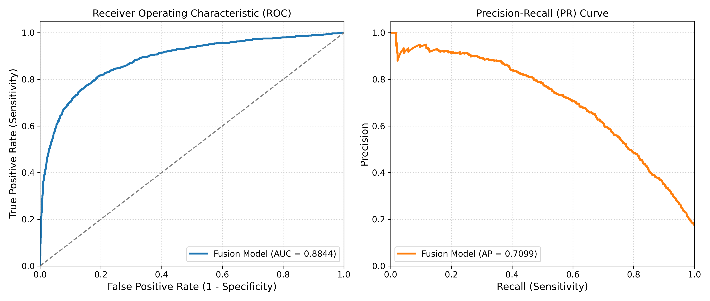
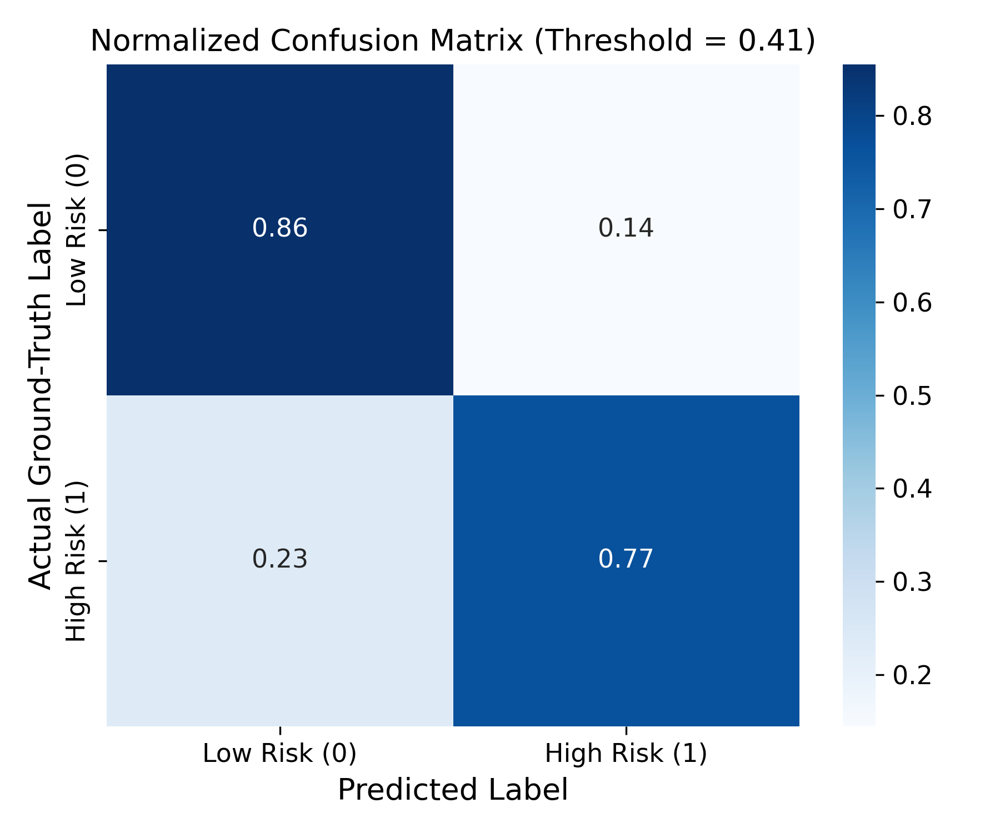
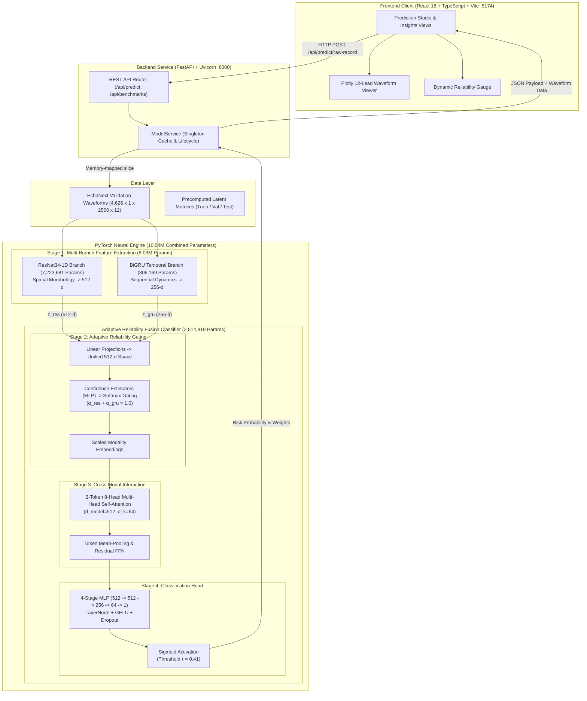

# CardioInsight: Multimodal Deep Learning for ECG-Based Detection of Left Ventricular Systolic Dysfunction

[](https://www.python.org/)
[](https://pytorch.org/)
[](https://fastapi.tiangolo.com/)
[](https://react.dev/)
[](https://www.typescriptlang.org/)
[](https://vitejs.dev/)
[](https://tailwindcss.com/)
[](https://plotly.com/javascript/)


> **CardioInsight** is an end-to-end deep learning framework and clinical research dashboard for detecting **Left Ventricular Systolic Dysfunction (LVSD, defined as echocardiographic $\text{LVEF} \le 45\%$)** from standard 12-lead electrocardiograms (ECGs) as an early risk marker for heart failure. It integrates a 34-layer 1D Residual Convolutional Network (ResNet34-1D) for morphological feature extraction and a 3-layer Bidirectional Gated Recurrent Unit with Bahdanau attention (BiGRU) for temporal rhythm dynamics, coupled via an **Adaptive Reliability Fusion** mechanism with confidence-weighted softmax gating and cross-modal multi-head attention.

---

## Table of Contents

- [1. Project Overview](#1-project-overview)
- [2. Application Preview & Research Visualizations](#2-application-preview--research-visualizations)
- [3. Key Features](#3-key-features)
- [4. System Architecture](#4-system-architecture)
- [5. Machine Learning Methodology](#5-machine-learning-methodology)
- [6. Dataset & Provenance](#6-dataset--provenance)
- [7. Verified Performance Metrics](#7-verified-performance-metrics)
- [8. Repository Structure](#8-repository-structure)
- [9. Installation & Local Setup](#9-installation--local-setup)
- [10. Training & Evaluation Pipelines](#10-training--evaluation-pipelines)
- [11. REST API Documentation](#11-rest-api-documentation)
- [12. Technology Stack](#12-technology-stack)
- [13. Limitations & Engineering Roadmap](#13-limitations--engineering-roadmap)
- [14. Disclaimer](#14-disclaimer)
- [15. References & Acknowledgements](#15-references--acknowledgements)

---

## 1. Project Overview

### The Clinical Problem
Heart failure affects more than 64 million individuals worldwide and is associated with substantial morbidity, frequent hospitalization, and high mortality. Early, asymptomatic structural and functional cardiac changes frequently present as **Left Ventricular Systolic Dysfunction (LVSD)**, characterized by a reduced Left Ventricular Ejection Fraction ($\text{LVEF} \le 45\%$). Left ventricular systolic dysfunction is the primary precursor to Heart Failure with Reduced or Mildly Reduced Ejection Fraction (HFrEF / HFmrEF). While transthoracic echocardiography (TTE) serves as the definitive diagnostic standard for quantifying ejection fraction, routine population-scale echocardiographic screening is constrained by equipment costs, operator dependency, and limited outpatient accessibility.

### The Opportunity in 12-Lead Electrocardiography
The standard 10-second 12-lead ECG is routine, non-invasive, accessible, and inexpensive. Subtle structural cardiac remodeling, conduction delays, and repolarization abnormalities leave subtle electrophysiological footprints in both localized wave morphologies (e.g., QRS widening, ST-segment deviations, T-wave inversions) and sequential rhythm dynamics across leads over time.

### What CardioInsight Does
CardioInsight analyzes standard 10-second 12-lead ECG waveforms (sampled at 250 Hz, 2,500 samples per lead) through two complementary neural pathways:
1. **Morphological Pathway (ResNet34-1D, 7.22M parameters):** Extracts localized spatial wave patterns across the 12 leads into a 512-dimensional embedding.
2. **Temporal Pathway (BiGRU + Bahdanau Attention, 0.81M parameters):** Captures multi-beat sequential rhythm dynamics and long-range dependencies into a 256-dimensional embedding.
3. **Adaptive Reliability Fusion (ARF, 2.51M parameters):** Dynamically computes per-sample reliability scores ($\alpha_{\text{res}}$ and $\alpha_{\text{gru}}$), enforces convex weight normalization ($\alpha_{\text{res}} + \alpha_{\text{gru}} = 1.0$), and enables cross-modal interaction through 8-head self-attention before final classification via a 4-stage regularized MLP with GELU activations.

### Target Label: Echocardiographic Surrogate vs. Clinical Diagnosis
CardioInsight targets an objective echocardiographic biomarker: **$\text{LVEF} \le 45\%$ (`lvef_lte_45_flag`)**, indicating Left Ventricular Systolic Dysfunction.

**Critical distinction:**
- The model predicts **echocardiographic systolic dysfunction (LVEF $\le 45\%$)**, which serves as an established physiological risk factor and structural precursor for heart failure.
- The model does **not** provide an autonomous clinical diagnosis of Chronic Heart Failure (CHF). CHF is a complex clinical syndrome that requires documented clinical symptoms (e.g., dyspnea, orthopnea, fatigue) and physical signs (e.g., elevated jugular venous pressure, peripheral edema). Furthermore, approximately 50% of heart failure patients exhibit Heart Failure with Preserved Ejection Fraction (HFpEF, $\text{LVEF} \ge 50\%$), which is strictly negative ($0$) under the `lvef_lte_45_flag`.

---

## 2. Application Preview & Research Visualizations

The CardioInsight interactive suite comprises a Single-Page Application (SPA) frontend developed with **React 18**, **TypeScript**, and **Tailwind CSS**, communicating with a high-throughput **FastAPI** backend that runs real-time PyTorch inference.

### Core Application Views

| View | Purpose | Technical Highlights |
|---|---|---|
| **Home Dashboard** | Overview & navigation | System status indicator, summary metrics, quick presets |
| **Prediction Studio** | Interactive ECG inference | Full 12-lead waveform visualization via Plotly (250 Hz, 10s), lead selector (I–V6), risk probability gauge, dynamic reliability weight bars ($\alpha_{\text{res}}$ vs. $\alpha_{\text{gru}}$) |
| **Model Insights** | Explainability & auditability | Interactive 4-stage neural pipeline diagram, verified benchmark tables across splits and operating thresholds, normalized confusion matrix, and feature embedding inspections |

> *Note for repository visitors: To run the frontend locally, execute `npm run dev` inside `frontend/` and navigate to `http://localhost:5174` (configured in `frontend/vite.config.ts`).*

### Verified Research & Evaluation Figures

The figures below were generated directly from the holdout test set evaluation ($N = 5,442$) using `evaluation/visualize_results.py`:

#### 1. Receiver Operating Characteristic & Precision-Recall Curves
The model achieves a **Test ROC-AUC of 88.44%** and a **Test PR-AUC of 70.99%** across the independent holdout evaluation split ($N = 5,442$), demonstrating discriminative capacity under a 4.66:1 negative-to-positive class imbalance.



#### 2. Normalized Confusion Matrix (Decision Threshold = 0.41)
At the validation-calibrated operating point ($\tau = 0.41$), the model prioritizes clinical sensitivity for screening, identifying **76.51%** of positive cases (736 / 962) with **85.51%** specificity (3,831 / 4,480 true negatives).



#### 3. Modality Reliability Distributions ($\alpha_{\text{res}}$ vs. $\alpha_{\text{gru}}$)
Across 5,442 test records, the adaptive gating mechanism dynamically adjusts modality weights. The sequential temporal branch receives an average weight of **69.90%** ($\alpha_{\text{gru}}$), while the morphological branch receives **30.10%** ($\alpha_{\text{res}}$), strictly satisfying $\alpha_{\text{res}} + \alpha_{\text{gru}} = 1.0$ for every sample.


---

## 3. Key Features

- **Genuine End-to-End Waveform Inference:** The backend endpoint `POST /api/predict/raw-record` loads real 10-second 12-lead ECG waveforms directly from `data/raw/EchoNext_val_waveforms.npy`, executes forward passes through both neural backbones, and returns calibrated predictions in real time.
- **Interactive Multi-Lead Waveform Inspection:** Built with Plotly.js, allowing clinicians and researchers to pan, zoom, and inspect individual leads (Leads I, II, III, aVR, aVL, aVF, V1–V6) with 1,250 points per lead (downsampled by 2 for web display from original 2,500 points).
- **Dynamic Modality Attribution:** Displays live reliability gating weights ($\alpha_{\text{res}}$ and $\alpha_{\text{gru}}$) for every inference call, highlighting whether the decision was driven primarily by sequential beat dynamics or wave morphology.
- **Dual-Threshold Evaluation Suite:** Benchmarked at both the standard $0.50$ baseline and the validation-calibrated $0.41$ clinical cutoff, designed to prioritize sensitivity in screening scenarios.
- **Decoupled Modular Architecture:** Cleanly organized into modular packages (`models/`, `training/`, `evaluation/`, `data/`, `config/`, and `backend/`).
- **Validation Cohort Scope:** The current web application operates across the **4,626 validation ECG records** included in the local environment; arbitrary external file uploads are scoped for future releases.

---

## 4. System Architecture

CardioInsight couples a responsive client frontend with an asynchronous backend service and a multi-stage PyTorch neural engine.



### Parameter Breakdown
- **ResNet34-1D Encoder:** 7,223,681 parameters.
- **BiGRU Temporal Encoder:** 806,169 parameters.
- **Adaptive Reliability Fusion Classifier (`ECGFusionClassifier`):** 2,514,819 parameters (100% trainable).
- **Combined End-to-End Pipeline:** 10,544,669 total parameters.

---

## 5. Machine Learning Methodology

### 1. Input Signal Specifications
Each electrocardiogram consists of 12 standard leads ($I, II, III, aVR, aVL, aVF, V1, V2, V3, V4, V5, V6$) recorded for 10 seconds at a sampling frequency of 250 Hz, yielding an input tensor shape of:
$$\mathbf{X} \in \mathbb{R}^{B \times 12 \times 2500}$$

### 2. Morphological Branch: ResNet34-1D
The morphological encoder adapts deep residual learning to one-dimensional biosignals:
- **Input Projection:** 1D convolution ($7 \times 1$, stride 2, 64 filters) followed by BatchNorm1d, ReLU, and MaxPool1d ($3 \times 1$, stride 2).
- **Residual Blocks:** 16 BasicBlocks distributed across 4 stages with channel depths $[64, 128, 256, 512]$ and downsampling strides of 2 between stages.
- **Global Pooling:** Adaptive Average Pooling collapses the temporal axis to produce a spatial morphological representation:
  $$\mathbf{z}_{\text{res}} \in \mathbb{R}^{512}$$

### 3. Temporal Branch: Stacked BiGRU with Bahdanau Attention
The temporal encoder models sequential dependencies and beat-to-beat rhythm dynamics:
- **Recurrent Backbone:** 3 stacked Bidirectional GRU layers (hidden dimension 128 per direction, resulting in 256 dimensions per timestep), interleaved with LayerNorm, residual skip projections, and dropout (0.3).
- **Bahdanau Temporal Attention:** An additive attention layer computes time-step relevance using a non-linear $\tanh$ projection:
  $$e_t = \mathbf{v}^\top \tanh(\mathbf{W}_a \mathbf{h}_t), \quad a_t = \frac{\exp(e_t)}{\sum_{k=1}^T \exp(e_k)}, \quad \mathbf{z}_{\text{gru}} = \sum_{t=1}^T a_t \mathbf{h}_t \in \mathbb{R}^{256}$$

### 4. Adaptive Reliability Fusion (ARF)
Rather than static concatenation, CardioInsight dynamically estimates the quality and discriminative confidence of each modality per sample:

1. **Space Alignment:** Linear layers project both features into a common latent dimension:
   $$\mathbf{h}_{\text{res}} = \mathbf{W}_{\text{res}} \mathbf{z}_{\text{res}} \in \mathbb{R}^{512}, \quad \mathbf{h}_{\text{gru}} = \mathbf{W}_{\text{gru}} \mathbf{z}_{\text{gru}} \in \mathbb{R}^{512}$$
2. **Reliability Confidence Scoring:** Non-linear two-layer MLPs ($512 \to 128 \to 1$ with GELU) compute unconstrained scalar scores $s_{\text{res}}$ and $s_{\text{gru}}$.
3. **Softmax Gating:** Scores are normalized via a softmax function:
   $$\alpha_{\text{res}}, \alpha_{\text{gru}} = \text{Softmax}([s_{\text{res}}, s_{\text{gru}}]), \quad \text{where } \alpha_{\text{res}} + \alpha_{\text{gru}} = 1.0$$
4. **Modality Token Scaling:** Features are scaled by their reliability weights:
   $$\tilde{\mathbf{h}}_{\text{res}} = \alpha_{\text{res}} \mathbf{h}_{\text{res}}, \quad \tilde{\mathbf{h}}_{\text{gru}} = \alpha_{\text{gru}} \mathbf{h}_{\text{gru}}$$
5. **Cross-Modal Self-Attention:** The two modality tokens $\mathbf{T} = [\tilde{\mathbf{h}}_{\text{res}}; \tilde{\mathbf{h}}_{\text{gru}}] \in \mathbb{R}^{2 \times 512}$ pass through an 8-head multi-head self-attention block ($d_{\text{model}} = 512, d_k = 64$) with residual LayerNorm.
6. **Token Aggregation:** Tokens are mean-pooled and passed through a residual Feed-Forward Network (FFN) with LayerNorm and Dropout (0.3).

### 5. Classification Head & Loss Formulation
- **Classifier MLP Architecture:** 4 linear stages:
  $$\mathbb{R}^{512} \xrightarrow[\text{LayerNorm, GELU, Dropout(0.3)}]{\text{Linear}} \mathbb{R}^{512} \xrightarrow[\text{LayerNorm, GELU, Dropout(0.2)}]{\text{Linear}} \mathbb{R}^{256} \xrightarrow[\text{GELU}]{\text{Linear}} \mathbb{R}^{64} \xrightarrow{}{\text{Linear}} \mathbb{R}^{1}$$
- **Hybrid Objective Function:** To address class imbalance ($w_{\text{pos}} = 55,513 / 16,962 = 3.2728$), training minimizes an exact $70/30$ weighted composite of positive-weighted Binary Cross-Entropy and Focal Loss:
  $$\mathcal{L}_{\text{total}} = 0.70 \cdot \text{BCE}_{\text{weighted}}(y, \hat{y}; w_{\text{pos}}=3.2728) + 0.30 \cdot \text{FocalLoss}(y, \hat{y}; \gamma=2.0, \alpha=0.25)$$
- **Optimization Strategy:** AdamW ($\text{lr} = 3 \times 10^{-4}$, weight decay $1 \times 10^{-4}$), Cosine Annealing with Warm Restarts, gradient clipping at norm 1.0, Exponential Moving Average (EMA, decay 0.999), and Early Stopping (patience = 8 epochs).

### 6. Training vs. Inference Pipeline Distinction
- **Fusion Training (`train.py`):** Trains the 2,514,819 parameters of `ECGFusionClassifier` using precomputed 512-d ResNet34 and 256-d BiGRU latent feature representations. It does not train the raw convolutional or recurrent backbone encoders from scratch.
- **Waveform Inference (`POST /api/predict/raw-record`):** Loads the trained ResNet34-1D and BiGRU checkpoints alongside the fusion classifier to execute full end-to-end inference directly from raw 12-lead waveforms.

---

## 6. Dataset & Provenance

### Cohort Origin
CardioInsight uses data derived from **EchoNext v1.1.1** (*A Dataset for Detecting Echocardiogram-Confirmed Structural Heart Disease from ECGs*). The target label is `lvef_lte_45_flag`, corresponding to echocardiogram-confirmed Left Ventricular Ejection Fraction $\le 45\%$ (Left Ventricular Systolic Dysfunction).

### Cohort Partitioning & Label Distribution

| Split | Sample Count ($N$) | Data Representation in Repo | Class Distribution (Neg : Pos) | Ratio (Neg : Pos) | Primary Role |
|---|---|---|---|---|---|
| **Training** | 72,475 | Precomputed 512-d (ResNet) & 256-d (BiGRU) features | 55,513 : 16,962 (23.40% pos) | 3.2728 : 1 | Fusion model training & EMA optimization |
| **Validation** | 4,626 | **Both** raw 12-lead waveforms & precomputed features | 3,760 : 866 (18.72% pos) | 4.3418 : 1 | Operating threshold calibration & Live Web Studio |
| **Holdout Test** | 5,442 | Precomputed 512-d (ResNet) & 256-d (BiGRU) features | 4,480 : 962 (17.68% pos) | 4.6570 : 1 | Final holdout performance verification |

> **Data Storage Note:** The raw waveform file (`data/raw/EchoNext_val_waveforms.npy`, approximately 1.11 GB) is required for backend inference but is **not included in this GitHub repository** because of its size and data-distribution considerations. Users must obtain the EchoNext v1.1.1 dataset through its official distribution channel and prepare the validation waveform array at the specified path. The backend currently requires this file during startup. The training and test splits are represented through precomputed latent feature arrays.

### Lineage & Partition Independence Nuances
As audited in `audit_results/upstream_data_provenance.md`, the cached feature matrices originated from upstream extraction jobs without patient-level identifier strings attached to the arrays. While EchoNext partitions validation and test sets by taking only the latest ECG per patient, the training set allows multiple ECGs per patient. Because patient IDs are absent from the cached feature files, patient-level independence across splits cannot be independently established from the local repository files.

---

## 7. Verified Performance Metrics

All metrics reported below were audited and verified across both saved model checkpoints:
- **Primary Checkpoint:** `best_fusion_model.zip` (Epoch 7 peak validation composite score checkpoint).
- **Secondary Reference Checkpoint:** `FusionModel.zip` (Epoch 15 end-of-training state dict).

### Audited Performance by Split & Operating Threshold

| Evaluation Cohort | Evaluated Checkpoint | Threshold ($\tau$) | ROC-AUC | PR-AUC | Balanced Accuracy | Overall Accuracy | Sensitivity (Recall) | Specificity | Precision | F1-Score | MCC |
|---|---|---|---|---|---|---|---|---|---|---|---|
| **Validation Cohort** ($N=4,626$) | `best_fusion_model.zip` (Epoch 7) | **0.41 (Evaluated)** | **89.12%** | **74.13%** | **82.33%** | **84.28%** | **79.21%** | **85.45%** | **55.64%** | **65.36%** | **0.5705** |
| Validation Cohort ($N=4,626$) | `best_fusion_model.zip` (Epoch 7) | 0.50 (Standard)  | 89.12% | 74.13% | 82.39% | 86.40% | 75.98% | 88.80% | 60.98% | 67.66% | 0.5976 |
| **Holdout Test Cohort** ($N=5,442$) | `best_fusion_model.zip` (Epoch 7) | **0.41 (Evaluated)** | **88.44%** | **70.99%** | **81.01%** | **83.92%** | **76.51%** | **85.51%** | **53.14%** | **62.72%** | **0.5432** |
| Holdout Test Cohort ($N=5,442$) | `best_fusion_model.zip` (Epoch 7) | 0.50 (Standard)  | 88.44% | 70.99% | 80.54% | 85.70% | 72.56% | 88.53% | 57.59% | 64.21% | 0.5601 |
| *Validation Reference* ($N=4,626$) | `FusionModel.zip` (Epoch 15 State) | 0.50 (Notebook Cell 52) | 88.92% | 73.93% | 82.35% | 85.11% | 77.94% | 86.76% | 57.54% | 66.21% | 0.5801 |

### Reconciliation of Reported Metrics
1. **Validation ROC-AUC Discrepancy (88.92% vs. 89.12%):**
   - The **88.92% ROC-AUC / 82.35% Balanced Accuracy** figure originates from evaluating the end-of-training model state (`FusionModel.zip`, saved at Epoch 15 after early stopping) at threshold 0.50, exactly matching Cell 52 of `final-fusion-model.ipynb`.
   - The **89.12% ROC-AUC** figure belongs to the peak validation checkpoint (`best_fusion_model.zip`, saved at Epoch 7 when the composite validation score peaked).
2. **Clinical Sensitivity Trade-Off:**
   - On the holdout test set with `best_fusion_model.zip`, shifting from the standard threshold ($\tau = 0.50$) to the calibrated screening threshold ($\tau = 0.41$) improves sensitivity from **72.56% to 76.51%**, capturing an additional 38 patients with reduced LVEF (736 vs. 698) while maintaining an **85.51%** specificity.

### Threshold Selection & Leakage Nuances
- **Exploratory Analysis in Notebook:** During exploratory evaluation in Cell 61 of `final-fusion-model.ipynb`, Youden's J-statistic was computed on the test predictions (`labels_all, probs`), obtaining a test-specific cutoff of approximately `0.4697` used to render Cell 62's confusion matrix.
- **Audited Evaluation Protocol:** Our finalized evaluation protocol rejects test-set threshold fitting. The reported holdout test metrics strictly evaluate the holdout test set using the fixed threshold of **0.41** (predefined in `threshold.npy`).
- **Audit Disclosure:** Because the exploratory notebook performed an in-sample threshold search on test predictions and patient identifiers cannot be independently verified from the feature arrays, the experimental history is not presented as completely leakage-free or fully unbiased.

---

## 8. Repository Structure

```text
CardioInsight/
├── audit_results/                 # Audited verification figures & reports
│   ├── confusion_matrix.png       # Normalized confusion matrix (Test N=5,442)
│   ├── reliability_distributions.png # Modality weighting distributions
│   ├── reproduced_evaluation_report.md # Step-by-step reproduction audit log
│   ├── roc_pr_curves.png          # High-resolution ROC and PR curves
│   └── upstream_data_provenance.md# Data lineage & Kaggle manifest audit
├── backend/                       # Production FastAPI backend application
│   ├── app/
│   │   ├── api/
│   │   │   ├── routes_insights.py # GET /api/benchmarks, GET /api/model-info
│   │   │   └── routes_predict.py  # POST /api/predict/raw-record, /api/predict
│   │   ├── schemas/               # Pydantic v2 request/response contracts
│   │   ├── services/
│   │   │   └── model_service.py   # Model inference singleton & mmap waveform loader
│   │   └── main.py                # FastAPI factory & CORS middleware configuration
│   └── requirements.txt           # Production backend dependencies
├── frontend/                      # React 18 + TypeScript + Vite SPA
│   ├── src/
│   │   ├── api/client.ts          # Strongly typed fetch client
│   │   ├── components/            # Plotly ECG viewer, ConfusionMatrix, Reliability bars
│   │   ├── pages/                 # HomePage, PredictionStudioPage, ModelInsightsPage
│   │   └── types/index.ts         # TypeScript schema definitions
│   ├── package.json               # NPM package configuration
│   ├── tailwind.config.js         # Custom Warm Stone / Medical Slate theme
│   └── vite.config.ts             # Vite build & local dev server config (Port 5174)
├── config/                        # Unified configuration management
│   └── config.py                  # Dataclass configs for paths, models, and training
├── data/                          # Data loaders & raw signal storage
│   ├── raw/
│   │   └── EchoNext_val_waveforms.npy # Required locally; not included in GitHub
│   └── dataset.py                 # PyTorch Dataset and mmap array loaders
├── models/                        # PyTorch model definitions
│   ├── resnet_model.py            # ResNet34-1D morphological encoder (7.22M params)
│   ├── bigru_model.py             # Stacked BiGRU + Bahdanau attention encoder (0.81M params)
│   └── fusion_model.py            # Adaptive Reliability Fusion & classifier (2.51M params)
├── training/                      # Modular training pipeline
│   ├── callbacks.py               # EarlyStopping & Exponential Moving Average (EMA)
│   ├── losses.py                  # 70/30 Weighted BCE + Focal Loss hybrid objective
│   └── trainer.py                 # PyTorch FusionTrainer execution class
├── evaluation/                    # Verification & visualization scripts
│   ├── evaluator.py               # Evaluation loops & batch metric computers
│   ├── metrics.py                 # ROC-AUC, PR-AUC, Balanced Acc, Specificity
│   ├── threshold.py               # Threshold evaluation utilities
│   └── visualize_results.py       # Publication figure generation script
├── train.py                       # Standalone CLI fusion training entry point
├── best_fusion_model.zip          # Verified peak validation checkpoint (Epoch 7)
├── final-fusion-model.ipynb       # Original exploratory research notebook (preserved)
└── README.md                      # Comprehensive project documentation
```

---

## 9. Installation & Local Setup

The project can be run natively on **Windows 10/11** using PowerShell or Command Prompt.

### Prerequisites
- **Python:** 3.10, 3.11, or 3.12 (64-bit)
- **Node.js:** v18.0.0 or later (with `npm`)
- **Memory:** Minimum 8 GB RAM (16 GB recommended for memory-mapped waveform processing)

### Step 1: Clone the Repository
```cmd
git clone https://github.com/Shreya-Sharma03/CardioInsight.git
cd CardioInsight
```

### Step 2: Set Up Python Virtual Environment & Backend
```cmd
:: Create and activate Python virtual environment
python -m venv venv
call venv\Scripts\activate

:: Upgrade pip and install backend dependencies
python -m pip install --upgrade pip
pip install -r backend/requirements.txt
```

### Step 3: Install Frontend Dependencies
```cmd
cd frontend
npm install
cd ..
```

### Step 4: Verify Required Data & Model Files
Ensure that the model checkpoints and data arrays are positioned as follows:
- `best_fusion_model.zip` (in project root)
- `data/raw/EchoNext_val_waveforms.npy` (in `data/raw/`)
- `resnet_features_*.npy`, `bigru_features_*.npy`, `resnet_labels_*.npy` (in project root)

### Step 5: Start the Backend Service
In your activated Python terminal:
```cmd
uvicorn backend.app.main:app --host 127.0.0.1 --port 8000 --reload
```
*The FastAPI backend will start at `http://127.0.0.1:8000`. You can inspect the interactive OpenAPI Swagger documentation at `http://127.0.0.1:8000/docs`.*

### Step 6: Start the Frontend Application
Open a new terminal window:
```cmd
cd frontend
npm run dev
```
*The Vite development server will start at `http://localhost:5174` (as configured in `vite.config.ts`). Open this URL in any modern browser.*

---

## 10. Training & Evaluation Pipelines

### 1. Training the Fusion Architecture
The modular training script `train.py` loads the precomputed 512-d ResNet34 and 256-d BiGRU representations, configures mixed-precision AMP, and trains the Adaptive Reliability Fusion model:

```cmd
python train.py --epochs 40 --batch-size 512 --lr 0.0003 --device cuda --save-path best_fusion_model.pth
```

**Supported CLI Arguments:**
- `--epochs` (int, default: 40): Maximum training epochs before early stopping.
- `--batch-size` (int, default: 512): Mini-batch size.
- `--lr` (float, default: 3e-4): AdamW initial learning rate.
- `--device` (str, default: auto-detected cuda/cpu): Compute target.
- `--save-path` (str, default: `best_fusion_model.pth`): Output path for the checkpoint.

*Note: `train.py` trains the fusion classifier using pre-extracted feature arrays; it does not retrain the raw ResNet34 or BiGRU backbones.*

### 2. Evaluating the Holdout Test Set & Generating Figures
To evaluate metrics across the 5,442 holdout test cases and generate publication-grade figures:

```cmd
python evaluation/visualize_results.py --checkpoint best_fusion_model.zip --threshold 0.41 --save-dir audit_results
```

**Expected Outputs (Saved to `--save-dir`):**
- `roc_pr_curves.png`: High-resolution dual plot of ROC and Precision-Recall curves.
- `confusion_matrix.png`: Normalized confusion matrix at $\tau = 0.41$.
- `reliability_distributions.png`: KDE distribution comparing $\alpha_{\text{res}}$ and $\alpha_{\text{gru}}$.

---

## 11. REST API Documentation

The FastAPI backend exposes strongly typed endpoints governed by Pydantic v2 schemas.

### Core Endpoints Summary

| Method | Endpoint | Description |
|---|---|---|
| `GET` | `/api/health` | Health check, device status, and checkpoint verification |
| `GET` | `/api/records` | Summary of available validation ECG records (0–4625) & clinical presets |
| `POST` | `/api/predict/raw-record` | **Primary:** End-to-end inference on raw 12-lead waveform array with signal return |
| `POST` | `/api/predict` | Fast inference on precomputed latent feature vectors (legacy mode) |
| `GET` | `/api/benchmarks` | Verified benchmark metrics across validation and holdout test splits |
| `GET` | `/api/model-info` | Architectural specifications, layer configurations, and parameter counts |

### Endpoint Details & Example Payloads

#### `POST /api/predict/raw-record`
Runs end-to-end inference directly on a raw 10-second 12-lead ECG waveform loaded via memory-mapping, returning classification probabilities, dynamic modality weights, latent embedding norms, and downsampled waveform signals.

**Request:**
```json
{
  "record_index": 42,
  "threshold": 0.41
}
```

**Illustrative Response matching `RawPredictResponse` schema (HTTP 200 OK):**
```json
{
  "record_index": 42,
  "probability": 0.9499,
  "risk_category": "HIGH RISK",
  "is_high_risk": true,
  "decision_threshold": 0.41,
  "reliability_weights": {
    "resnet34": 0.3125,
    "bigru": 0.6875,
    "weights_sum": 1.0
  },
  "embeddings_summary": {
    "resnet_dim": 512,
    "resnet_norm": 4.82,
    "bigru_dim": 256,
    "bigru_norm": 3.15
  },
  "waveform": {
    "lead_names": ["I", "II", "III", "aVR", "aVL", "aVF", "V1", "V2", "V3", "V4", "V5", "V6"],
    "sampling_rate_hz": 250,
    "duration_seconds": 10.0,
    "total_samples": 1250,
    "original_samples": 2500,
    "time_axis": [0.0, 0.008, 0.016, 0.024],
    "leads": {
      "I": [0.012, 0.018, 0.025, 0.031],
      "II": [-0.045, -0.052, -0.060, -0.068],
      "V1": [0.120, 0.145, 0.170, 0.192]
    }
  },
  "inference_source": "raw_ecg_backbone_fusion"
}
```

#### `GET /api/benchmarks`
Returns verified classification metrics for validation and holdout test splits at thresholds 0.41 and 0.50.

---

## 12. Technology Stack

| Category | Technology | Version | Purpose in CardioInsight |
|---|---|---|---|
| **Deep Learning** | PyTorch | $\ge 2.0.0$ | Neural network architecture, AMP, custom loss functions |
| **Backend API** | FastAPI | $\ge 0.115.0$ | Asynchronous RESTful API framework and OpenAPI documentation |
| **ASGI Server** | Uvicorn | $\ge 0.30.0$ | High-throughput asynchronous application server |
| **Data Validation** | Pydantic | $\ge 2.8.0$ | Strict schema parsing and response validation |
| **Scientific Computing** | NumPy / SciPy | $\ge 1.24.0$ | Memory-mapped tensor manipulation and signal array processing |
| **Machine Learning** | Scikit-Learn | $\ge 1.3.0$ | ROC-AUC, PR-AUC, confusion matrix, and metric computation |
| **Frontend Framework** | React | 18.3.1 | Declarative component hierarchy and state management |
| **Language** | TypeScript | 5.6.2 | Compile-time type safety across frontend and API clients |
| **Build Tool** | Vite | 5.4.10 | Fast HMR development server and production bundler (Port 5174) |
| **Styling** | Tailwind CSS | 3.4.15 | Custom Medical Slate design system and responsive utility styling |
| **Waveform Plotting** | Plotly.js | 2.35.2 | Interactive 12-lead medical ECG waveform visualization |
| **UI Icons** | Lucide React | 0.460.0 | Accessible clinical and interface icons |

---

## 13. Limitations & Engineering Roadmap

### Current Limitations
1. **Research Prototype Boundary:** CardioInsight has been evaluated retrospectively on historical recordings. It has not undergone prospective clinical trials and must not be used as an independent diagnostic tool.
2. **Target Label Specificity:** The model predicts Left Ventricular Systolic Dysfunction ($\text{LVEF} \le 45\%$). It does not detect Heart Failure with Preserved Ejection Fraction (HFpEF, $\text{LVEF} \ge 50\%$), which constitutes roughly half of all clinical heart failure cases.
3. **Partition Independence & Feature Provenance:** Cached feature arrays were pre-extracted in upstream workflows without patient identifiers; patient-level separation cannot be independently verified from the local files.
4. **Validation Cohort Scope:** Live 12-lead raw waveform inference in the current web application is backed by the 4,626 validation ECG records from EchoNext v1.1.1. Arbitrary single-file upload (e.g., DICOM or WFDB format) is not yet supported in the web UI.
5. **Multi-Center Generalization:** Performance was audited on the EchoNext cohort; external validation on multi-center cohorts (e.g., PTB-XL, MIMIC-IV-ECG) is necessary to verify demographic and geographic robustness.

### Engineering Roadmap
- [ ] **DICOM & WFDB Ingestion Pipeline:** Implement a client-side and server-side parser for native clinical `.dat` and `.hea` ECG record formats.
- [ ] **ONNX Runtime Export:** Convert the PyTorch fusion model to quantized ONNX format for sub-10ms CPU inference.
- [ ] **Explainability Heatmaps:** Integrate Grad-CAM for the ResNet34-1D branch to highlight which specific leads and millisecond intervals trigger high risk scores.
- [ ] **Multi-Label Expansion:** Extend the classification head to predict composite structural heart disease labels beyond isolated LVEF $\le 45\%$.

---

## 14. Disclaimer

> "CardioInsight is a research prototype, not a diagnostic tool. Its predictions should not replace professional medical advice or clinical evaluation."

---

## 15. References & Acknowledgements

1. **EchoNext Dataset:** *A Dataset for Detecting Echocardiogram-Confirmed Structural Heart Disease from ECGs* (Version 1.1.1).
2. **Deep Residual Learning for 1D Biosignals:** He, K., et al. (2016). *Deep Residual Learning for Image Recognition.* Adapted for 12-lead electrocardiographic feature extraction.
3. **Bidirectional Recurrent Neural Networks with Attention:** Bahdanau, D., Cho, K., & Bengio, Y. (2014). *Neural Machine Translation by Jointly Learning to Align and Translate.*
4. **Focal Loss for Imbalanced Classification:** Lin, T.-Y., et al. (2017). *Focal Loss for Dense Object Detection.* IEEE Transactions on Pattern Analysis and Machine Intelligence.

---

**Author:** Shreya Sharma
**Institution:** Thapar Institute of Engineering & Technology
**Project Repository:** [https://github.com/Shreya-Sharma03/CardioInsight](https://github.com/Shreya-Sharma03/CardioInsight)
