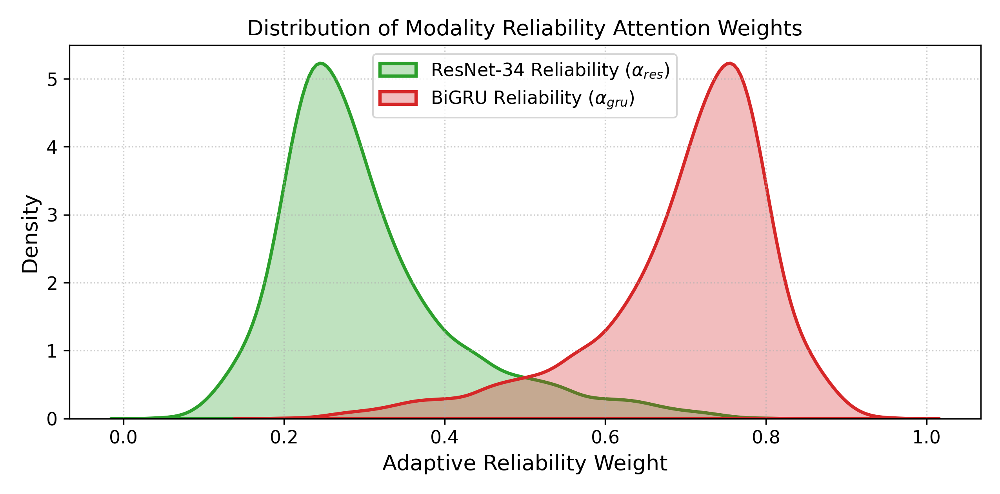
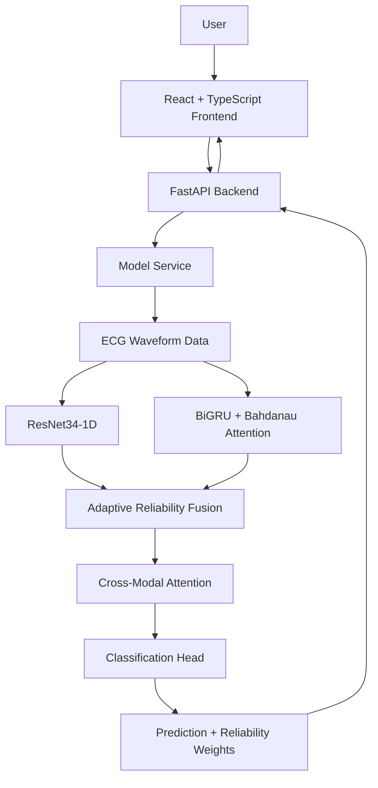
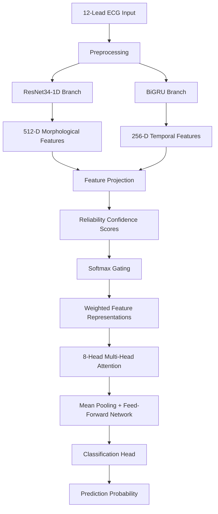

# CardioInsight
### Multimodal Deep Learning for ECG-Based Detection of Left Ventricular Systolic Dysfunction

<p align="center">
  A research-oriented deep learning application that combines ECG morphology, temporal rhythm analysis, and adaptive feature fusion to predict reduced left ventricular ejection fraction from 12-lead ECG recordings.
</p>

<p align="center">
  
  
  
  
  
  
  
</p>

---

## Table of Contents

1. [Project Overview](#1-project-overview)
2. [Problem Statement & Objective](#2-problem-statement--objective)
3. [Application Features](#3-application-features)
4. [System Architecture](#4-system-architecture)
5. [Deep Learning Methodology](#5-deep-learning-methodology)
6. [Dataset & Preprocessing](#6-dataset--preprocessing)
7. [Model Performance & Evaluation](#7-model-performance--evaluation)
8. [Technology Stack](#8-technology-stack)
9. [Repository Structure](#9-repository-structure)
10. [Installation & Setup](#10-installation--setup)
11. [Running the Application](#11-running-the-application)
12. [Training & Evaluation](#12-training--evaluation)
13. [REST API Documentation](#13-rest-api-documentation)
14. [Limitations & Future Improvements](#14-limitations--future-improvements)
15. [Disclaimer](#15-disclaimer)
16. [References & Acknowledgements](#16-references--acknowledgements)

---

## 1. Project Overview

**CardioInsight** is a multimodal deep learning project that explores the prediction of Left Ventricular Systolic Dysfunction (LVSD) from standard 12-lead Electrocardiogram (ECG) signals.

The project combines two complementary neural network architectures:

- **ResNet34-1D:** Learns morphological patterns from ECG waveforms.
- **BiGRU with Bahdanau Attention:** Learns temporal relationships and rhythm patterns.

Their learned representations are combined through an **Adaptive Reliability Fusion (ARF)** module, which dynamically assigns weights to the two feature branches before producing the final prediction.

The project also includes a web application built with React and TypeScript, connected to a FastAPI backend. It provides an interactive interface for ECG waveform inspection, prediction results, model performance metrics, and modality reliability analysis.

### Project at a Glance

| Component | Description |
|---|---|
| Project | CardioInsight |
| Problem domain | ECG-based prediction of reduced LVEF |
| Input | Standard 12-lead ECG |
| Signal duration | 10 seconds |
| Sampling frequency | 250 Hz |
| Samples per lead | 2,500 |
| Morphological model | ResNet34-1D |
| Temporal model | BiGRU + Bahdanau Attention |
| Fusion strategy | Adaptive Reliability Fusion |
| Backend | FastAPI |
| Frontend | React, TypeScript, Vite |
| Deep learning framework | PyTorch |
| Target label | `lvef_lte_45_flag` |
| Combined model parameters | 10,544,669 |

### What Makes CardioInsight Different?

Instead of simply concatenating features from two neural networks, CardioInsight uses adaptive reliability-based weighting.

This allows the model to assign different importance to morphological and temporal representations for individual ECG samples.

The project brings together:

1. Two complementary deep learning architectures.
2. Dynamic modality weighting.
3. Cross-modal attention.
4. Quantitative model evaluation.
5. An interactive ECG analysis application.

---

## 2. Problem Statement & Objective

### The Problem

The heart's electrical activity contains information about its structure and functioning. An ECG records this activity and is widely used in cardiovascular assessment.

However, identifying subtle patterns associated with reduced left ventricular ejection fraction can be challenging through conventional ECG interpretation alone.

Echocardiography is used to assess cardiac structure and quantify Left Ventricular Ejection Fraction (LVEF), but it requires specialized equipment and trained personnel.

### Project Objective

The objective of CardioInsight is to investigate whether deep learning models can identify ECG patterns associated with reduced LVEF.

The model predicts the following target:

**LVEF ≤ 45% (`lvef_lte_45_flag`)**

This target represents Left Ventricular Systolic Dysfunction.

It is important to distinguish this prediction from a diagnosis of heart failure. CardioInsight predicts an echocardiographic measurement-based label; it does not independently diagnose the clinical heart failure syndrome.

### Proposed Approach

| Challenge | Approach |
|---|---|
| Learning ECG waveform patterns | ResNet34-1D |
| Understanding temporal dependencies | Bidirectional GRU |
| Identifying important time steps | Bahdanau Attention |
| Combining different representations | Adaptive Reliability Fusion |
| Improving interaction between modalities | Multi-Head Self-Attention |
| Evaluating model performance | ROC-AUC, PR-AUC, sensitivity, specificity and other metrics |
| Making results accessible | React-based interactive dashboard |

---

## 3. Application Features

CardioInsight includes three main application views.

### 3.1 Home Dashboard

Provides an overview of the application and navigation to its main modules.

Key elements include:
- Application overview.
- Navigation to prediction and model insights.
- Model and application information.

### 3.2 Prediction Studio

Provides an interface for inspecting ECG records and viewing model predictions.

Features include:
- Selection of an available validation ECG record.
- Interactive visualization of all 12 ECG leads.
- Prediction probability and risk category.
- Configurable decision threshold.
- Dynamic ResNet34 and BiGRU reliability weights.
- Waveform inspection through interactive plots.

The current application uses the locally available validation waveform records rather than arbitrary external ECG uploads.

### 3.3 Model Insights

Provides access to model architecture information and evaluation results.

Features include:
- Overview of the deep learning pipeline.
- Model parameter counts.
- Validation and test performance metrics.
- Confusion matrix visualization.
- Modality reliability distribution.
- Feature representation information.

### Research Visualizations

The following figures summarize the reproduced evaluation results.

**ROC and Precision-Recall Curves**


**Confusion Matrix at Threshold 0.41**


**Modality Reliability Distribution**



---

## 4. System Architecture

CardioInsight follows a modular architecture consisting of a frontend, backend API, data layer, and deep learning pipeline.

### High-Level Architecture



### Deep Learning Pipeline



### Architecture Components

| Component | Responsibility |
|---|---|
| React Frontend | User interface and visualization |
| FastAPI Backend | API requests and response handling |
| Model Service | Model loading, caching and inference |
| Data Layer | ECG waveforms and precomputed feature arrays |
| ResNet34-1D | Morphological feature extraction |
| BiGRU | Temporal feature extraction |
| Adaptive Fusion | Dynamic feature weighting |
| Classification Head | Final prediction |

### Model Parameter Breakdown

| Model Component | Parameters | Output Dimension |
|---|---:|---:|
| ResNet34-1D | 7,223,681 | 512 |
| BiGRU | 806,169 | 256 |
| Adaptive Reliability Fusion | 2,514,819 | 1 |
| **Combined System** | **10,544,669** | **1** |

---

## 5. Deep Learning Methodology

CardioInsight uses two feature extraction branches followed by an adaptive fusion architecture.

### 5.1 Input ECG Representation

Each ECG record contains 12 standard leads:

`I, II, III, aVR, aVL, aVF, V1, V2, V3, V4, V5, V6`

The signal specifications are:

| Property | Value |
|---|---:|
| Number of leads | 12 |
| Recording duration | 10 seconds |
| Sampling frequency | 250 Hz |
| Samples per lead | 2,500 |

The model receives the processed signal in a channel-first representation:

$$
X \in \mathbb{R}^{B \times 12 \times 2500}
$$

where \(B\) represents the batch size.

### 5.2 ResNet34-1D: Morphological Feature Extraction

ResNet34-1D is responsible for learning local morphological patterns in ECG signals.

It is adapted from the residual learning architecture used in computer vision, with one-dimensional convolutional operations for sequential signals.

**Main components:**
- Initial convolution and max-pooling layers.
- 16 residual BasicBlocks across four stages.
- Batch normalization and ReLU activations.
- Residual connections.
- Adaptive average pooling.

The network produces a 512-dimensional feature representation:

$$
z_{\text{res}} \in \mathbb{R}^{512}
$$

**Purpose:** Capture morphological characteristics and local waveform patterns.

### 5.3 BiGRU with Bahdanau Attention: Temporal Feature Extraction

The temporal branch uses a three-layer Bidirectional Gated Recurrent Unit (BiGRU).

A GRU is a recurrent neural network architecture designed to learn dependencies in sequential data.

The bidirectional structure processes the sequence in both forward and backward directions, allowing it to capture information from both past and future time steps.

**Architecture details:**
- Three bidirectional GRU layers.
- Hidden dimension of 128 per direction.
- 256-dimensional output at each time step.
- Layer normalization and residual projections.
- Dropout regularization.
- Bahdanau-style additive attention.

The attention mechanism assigns importance scores to different time steps.

$$
e_t = v^T \tanh(W_a h_t)
$$

$$
a_t = \frac{\exp(e_t)}{\sum_{k=1}^{T}\exp(e_k)}
$$

The final temporal representation is obtained through weighted aggregation:

$$
z_{\text{gru}} = \sum_{t=1}^{T} a_t h_t
$$

The resulting feature vector has 256 dimensions.

**Purpose:** Capture sequential patterns and temporal dependencies in ECG signals.

### 5.4 Adaptive Reliability Fusion (ARF)

The two branches generate different feature representations:

- ResNet34-1D: 512 dimensions.
- BiGRU: 256 dimensions.

These representations are projected into a common 512-dimensional feature space.

Instead of assigning fixed importance to both branches, the fusion module estimates their relative reliability for each sample.

**Fusion process:**

1. **Feature Projection:** Both feature vectors are transformed into a common representation space.
2. **Confidence Estimation:** Separate confidence estimators generate scores for the two modalities.
3. **Softmax Gating:** The scores are converted into normalized reliability weights.
4. **Feature Weighting:** Each feature representation is multiplied by its corresponding weight.
5. **Cross-Modal Attention:** The two weighted modality representations interact through an 8-head multi-head attention layer.
6. **Feature Aggregation:** Mean pooling and a residual feed-forward network produce the final fused representation.

The reliability weights satisfy:

$$
\alpha_{\text{res}} + \alpha_{\text{gru}} = 1
$$

The final fused representation is passed to the classification head.

**Why use Adaptive Reliability Fusion?**

The two branches learn different types of information. Their usefulness may vary between ECG records. Adaptive weighting allows the network to adjust their relative contributions instead of treating both branches as equally reliable for every sample.

### 5.5 Classification Head

The fused 512-dimensional representation is passed through a multi-layer classifier.

The architecture follows:

$$
512 \rightarrow 512 \rightarrow 256 \rightarrow 64 \rightarrow 1
$$

It uses:
- Linear layers.
- GELU activation functions.
- Layer normalization.
- Dropout regularization.

The final output is converted into a probability using a sigmoid function.

### 5.6 Training Strategy

The fusion classifier is trained using precomputed ResNet34 and BiGRU feature representations.

**Important implementation detail:** The current modular training pipeline trains the Adaptive Reliability Fusion classifier. It does not retrain the ResNet34-1D and BiGRU backbone encoders from scratch.

The training objective combines weighted Binary Cross-Entropy and Focal Loss to address class imbalance.

$$
L_{\text{total}} = 0.70L_{\text{BCE}} + 0.30L_{\text{Focal}}
$$

The training configuration includes:
- AdamW optimizer.
- Learning rate of $3 \times 10^{-4}$.
- Weight decay.
- Cosine annealing with warm restarts.
- Gradient clipping.
- Exponential Moving Average (EMA).
- Early stopping.

---

## 6. Dataset & Preprocessing

### Dataset

CardioInsight uses data derived from **EchoNext v1.1.1**, a dataset for detecting echocardiogram-confirmed structural heart disease from ECGs.

The target variable is:

`lvef_lte_45_flag`

It indicates whether the corresponding echocardiographic LVEF measurement is less than or equal to 45%.

### Dataset Distribution

The available feature datasets are divided into training, validation, and test splits.

| Split | Records | Negative | Positive | Positive Percentage |
|---|---:|---:|---:|---:|
| Training | 72,475 | 55,513 | 16,962 | 23.40% |
| Validation | 4,626 | 3,760 | 866 | 18.72% |
| Test | 5,442 | 4,480 | 962 | 17.68% |
| **Total** | **82,543** | **63,753** | **18,790** | **22.76%** |

### Data Representations

The project uses two types of data:

**1. Raw ECG Waveforms**

The validation waveform array is used by the Prediction Studio for raw-record inference.

- Shape: `[4626, 1, 2500, 12]`
- Sampling frequency: 250 Hz.
- Duration: 10 seconds per record.

**2. Precomputed Feature Arrays**

The training and evaluation pipeline uses pre-extracted representations from the two backbone models.

| Feature Array | Shape |
|---|---|
| ResNet training features | `(72475, 512)` |
| BiGRU training features | `(72475, 256)` |
| Training labels | `(72475,)` |
| ResNet validation features | `(4626, 512)` |
| BiGRU validation features | `(4626, 256)` |
| Validation labels | `(4626,)` |
| ResNet test features | `(5442, 512)` |
| BiGRU test features | `(5442, 256)` |
| Test labels | `(5442,)` |

### Data Availability

The raw waveform file:

`data/raw/EchoNext_val_waveforms.npy`

is approximately 1.11 GB and is **not included in this GitHub repository**.

It must be obtained separately through the appropriate dataset distribution channel and placed at the expected location.

The model checkpoints and precomputed feature arrays are also required for the corresponding inference and training workflows.

Users must ensure that they have appropriate authorization to access and process the dataset and comply with its applicable data-use, distribution, and privacy requirements.

### Data Provenance Note

The cached feature arrays do not contain patient identifiers. Therefore, patient-level independence between the training, validation, and test splits cannot be independently verified using the available feature files alone.

This is an important consideration when interpreting the reported evaluation results.

---

## 7. Model Performance & Evaluation

The fusion classifier was evaluated using validation and holdout test feature sets.

The reported results use the peak validation checkpoint:

`best_fusion_model.zip` — Epoch 7.

Two decision thresholds are reported:

- **0.41:** Validation-selected operating threshold.
- **0.50:** Standard probability threshold.

### 7.1 Performance Summary

| Metric | Validation (0.41) | Validation (0.50) | Test (0.41) | Test (0.50) |
|---|---:|---:|---:|---:|
| ROC-AUC | 89.12% | 89.12% | 88.44% | 88.44% |
| PR-AUC | 74.13% | 74.13% | 70.99% | 70.99% |
| Balanced Accuracy | 82.33% | 82.39% | 81.01% | 80.54% |
| Accuracy | 84.28% | 86.40% | 83.92% | 85.70% |
| Sensitivity | 79.21% | 75.98% | 76.51% | 72.56% |
| Specificity | 85.45% | 88.80% | 85.51% | 88.53% |
| Precision | 55.64% | 60.98% | 53.14% | 57.59% |
| F1-Score | 65.36% | 67.66% | 62.72% | 64.21% |

### 7.2 Understanding the Results

**ROC-AUC — 88.44% on the test set**

Measures how well the model distinguishes between the two target classes across different thresholds.

**PR-AUC — 70.99% on the test set**

Summarizes the precision-recall trade-off and is useful when working with imbalanced datasets.

**Sensitivity — 76.51% at threshold 0.41**

Measures the proportion of actual positive records correctly identified by the model.

**Specificity — 85.51% at threshold 0.41**

Measures the proportion of actual negative records correctly identified by the model.

### 7.3 Confusion Matrix at Threshold 0.41

| | Predicted Negative | Predicted Positive |
|---|---:|---:|
| Actual Negative | 3,831 | 649 |
| Actual Positive | 226 | 736 |

The threshold of 0.41 provides higher sensitivity than the standard 0.50 threshold on the test set, with a corresponding reduction in specificity.

The threshold was selected using validation results rather than fitted to the final test predictions.

### 7.4 Modality Reliability Analysis

The fusion model dynamically adjusts the contribution of its two feature branches.

On the test set, the average reliability weights were:

| Modality | Average Weight |
|---|---:|
| ResNet34-1D | 30.10% |
| BiGRU | 69.90% |

These are averages across the test records. Individual samples can receive different modality weights.

---

## 8. Technology Stack

| Category | Technology | Purpose |
|---|---|---|
| Programming Language | Python | Model development and backend |
| Deep Learning | PyTorch | Neural network implementation |
| Numerical Computing | NumPy | ECG and feature array processing |
| Machine Learning | Scikit-learn | Evaluation metrics |
| Backend Framework | FastAPI | REST API development |
| API Server | Uvicorn | Running the backend application |
| Data Validation | Pydantic | Request and response schemas |
| Frontend Framework | React 18 | User interface |
| Frontend Language | TypeScript | Type-safe frontend development |
| Build Tool | Vite | Frontend development and build |
| Styling | Tailwind CSS | Responsive interface styling |
| Visualization | Plotly.js | Interactive ECG and metric plots |
| Icons | Lucide React | Interface icons |

---

## 9. Repository Structure

```text
CardioInsight/
│
├── backend/
│   ├── app/
│   │   ├── api/
│   │   │   ├── routes_insights.py
│   │   │   └── routes_predict.py
│   │   │
│   │   ├── schemas/
│   │   │   ├── insights.py
│   │   │   └── prediction.py
│   │   │
│   │   ├── services/
│   │   │   └── model_service.py
│   │   │
│   │   └── main.py
│   │
│   └── requirements.txt
│
├── frontend/
│   ├── src/
│   │   ├── api/
│   │   ├── components/
│   │   ├── pages/
│   │   ├── types/
│   │   ├── App.tsx
│   │   └── main.tsx
│   │
│   ├── package.json
│   ├── vite.config.ts
│   └── tailwind.config.js
│
├── models/
│   ├── resnet_model.py
│   ├── bigru_model.py
│   └── fusion_model.py
│
├── data/
│   ├── raw/
│   │   └── EchoNext_val_waveforms.npy
│   └── dataset.py
│
├── training/
│   ├── callbacks.py
│   ├── losses.py
│   └── trainer.py
│
├── evaluation/
│   ├── evaluator.py
│   ├── metrics.py
│   ├── threshold.py
│   └── visualize_results.py
│
├── config/
│   └── config.py
│
├── notebooks/
│   └── final_fusion_model.py
│
├── audit_results/
│   ├── confusion_matrix.png
│   ├── reliability_distributions.png
│   └── roc_pr_curves.png
│
├── train.py
├── requirements-ml.txt
└── README.md
```

*Note: Large local data arrays and model artifacts are not necessarily tracked in Git. The raw waveform file and required checkpoints must be supplied separately.*

---

## 10. Installation & Setup

### Prerequisites

Make sure the following are installed:

- Python 3.10 or later.
- Node.js 18 or later.
- npm.
- Git.
- A compatible PyTorch installation.

For local development, Windows 10/11 is supported.

### Step 1: Clone the Repository

```cmd
git clone https://github.com/Shreya-Sharma03/CardioInsight.git
cd CardioInsight
```

### Step 2: Create a Python Virtual Environment

```cmd
python -m venv venv
call venv\Scripts\activate.bat
```

Upgrade pip:

```cmd
python -m pip install --upgrade pip
```

### Step 3: Install Python Dependencies

Install the project dependencies from the root directory:

```cmd
pip install -r requirements-ml.txt
```

### Step 4: Install Frontend Dependencies

```cmd
cd frontend
npm install
cd ..
```

### Step 5: Configure Required Data and Model Files

Before starting the backend, ensure that the required files are available at the paths expected by the project configuration.

Important artifacts include:

- `best_fusion_model.zip`
- `ResNet34_ECG.pth.zip`
- `checkpoint_backup/BiGRU_ECG_repacked.zip`
- `data/raw/EchoNext_val_waveforms.npy`
- Precomputed ResNet34 feature arrays.
- Precomputed BiGRU feature arrays.
- Corresponding label arrays.

The raw waveform file is required for the Prediction Studio's raw-record inference workflow. The backend model service loads this data during initialization.

---

## 11. Running the Application

CardioInsight consists of two services: the FastAPI backend and the React frontend.

Both must be running to use the complete application.

### Step 1: Start the Backend

From the project root, activate the virtual environment and run:

```cmd
python -m uvicorn backend.app.main:app --host 127.0.0.1 --port 8000 --reload
```

The backend will be available at:

`http://127.0.0.1:8000`

Interactive API documentation:

`http://127.0.0.1:8000/docs`

### Step 2: Start the Frontend

Open a second terminal and navigate to the frontend directory:

```cmd
cd frontend
npm run dev
```

The frontend will be available at:

`http://localhost:5174`

Open the frontend URL in your browser to access CardioInsight.

---

## 12. Training & Evaluation

### 12.1 Fusion Model Training

The modular training pipeline uses precomputed ResNet34 and BiGRU feature arrays to train the Adaptive Reliability Fusion classifier.

Run from the project root:

```cmd
python train.py --help
```

This displays the training script's supported arguments.

The training workflow focuses on learning how to combine the two feature representations. It does not retrain the ResNet34 and BiGRU backbone encoders.

### 12.2 Model Evaluation

The evaluation modules calculate performance metrics on the validation and test feature sets.

They include:
- ROC-AUC.
- PR-AUC.
- Accuracy.
- Balanced accuracy.
- Sensitivity.
- Specificity.
- Precision.
- F1-score.
- Confusion matrix.

### 12.3 Generate Evaluation Visualizations

Run the evaluation visualization script:

```cmd
python evaluation/visualize_results.py --checkpoint best_fusion_model.zip --threshold 0.41 --save-dir audit_results
```

The generated figures include:

| File | Description |
|---|---|
| `roc_pr_curves.png` | ROC and Precision-Recall curves |
| `confusion_matrix.png` | Confusion matrix |
| `reliability_distributions.png` | Modality reliability distributions |

---

## 13. REST API Documentation

The backend uses FastAPI and Pydantic schemas to expose model inference and model-insight functionality.

### API Endpoint Summary

| Method | Endpoint | Description |
|---|---|---|
| `POST` | `/api/predict` | Prediction using precomputed feature representations |
| `POST` | `/api/predict/raw-record` | End-to-end inference using a raw ECG record |
| `GET` | `/api/benchmarks` | Retrieves evaluation benchmark metrics |
| `GET` | `/api/model-info` | Retrieves model architecture and parameter information |

### 13.1 Raw ECG Prediction

**Endpoint:**

```http
POST /api/predict/raw-record
```

**Example Request:**

```json
{
  "record_index": 42,
  "threshold": 0.41
}
```

The backend loads the selected ECG record, performs inference through both feature extraction branches and the fusion classifier, and returns the prediction with additional model information.

**Illustrative Response:**

```json
{
  "record_index": 42,
  "probability": 0.9499,
  "risk_category": "HIGH RISK",
  "is_high_risk": true,
  "decision_threshold": 0.41,
  "reliability_weights": {
    "resnet34": 0.3125,
    "bigru": 0.6875,
    "weights_sum": 1.0
  },
  "embeddings_summary": {
    "resnet_dim": 512,
    "resnet_norm": 4.82,
    "bigru_dim": 256,
    "bigru_norm": 3.15
  },
  "waveform": {
    "lead_names": [
      "I", "II", "III", "aVR", "aVL", "aVF",
      "V1", "V2", "V3", "V4", "V5", "V6"
    ],
    "sampling_rate_hz": 250,
    "duration_seconds": 10.0,
    "total_samples": 1250,
    "original_samples": 2500,
    "time_axis": [0.0, 0.008, 0.016],
    "leads": {
      "I": [0.012, 0.018, 0.025],
      "II": [-0.045, -0.052, -0.060],
      "III": [0.031, 0.035, 0.039],
      "aVR": [-0.012, -0.016, -0.020],
      "aVL": [0.018, 0.022, 0.026],
      "aVF": [0.025, 0.030, 0.034],
      "V1": [0.120, 0.145, 0.170],
      "V2": [0.110, 0.132, 0.154],
      "V3": [0.090, 0.105, 0.121],
      "V4": [0.070, 0.085, 0.099],
      "V5": [0.050, 0.064, 0.078],
      "V6": [0.035, 0.047, 0.059]
    }
  },
  "inference_source": "raw_ecg_backbone_fusion"
}
```

*The response above illustrates the response structure. Numeric values and waveform arrays are examples; actual responses contain the corresponding model outputs and waveform samples.*

### 13.2 Model Benchmarks

**Endpoint:**

```http
GET /api/benchmarks
```

Returns the available validation and test benchmark metrics.

### 13.3 Model Information

**Endpoint:**

```http
GET /api/model-info
```

Returns information about the model architecture and its parameter configuration.

### Interactive API Documentation

FastAPI provides automatically generated API documentation at:

`http://127.0.0.1:8000/docs`

---

## 14. Limitations & Future Improvements

### Current Limitations

1. **Research Prototype:** CardioInsight is an experimental research project and has not been validated for independent clinical use.

2. **Specific Prediction Target:** The model predicts the `lvef_lte_45_flag` label. It does not diagnose the complete clinical heart failure syndrome or identify all forms of heart failure, including HFpEF.

3. **Dataset Scope:** The current Prediction Studio uses the available validation ECG records. Arbitrary external ECG uploads are not currently supported.

4. **Data Availability:** The raw waveform dataset and model artifacts must be supplied separately to run the complete inference pipeline.

5. **Patient-Level Verification:** Patient identifiers are not available in the cached feature arrays, so patient-level separation across splits cannot be independently verified from those files.

6. **External Validation:** Further evaluation on independent, multi-center datasets is required to assess generalization across different populations and recording environments.

### Future Improvements

- [ ] Support for external ECG uploads and additional ECG file formats.
- [ ] External validation on independent datasets.
- [ ] More extensive model calibration and robustness evaluation.
- [ ] Additional explainability methods for ECG feature interpretation.
- [ ] Model optimization for efficient CPU inference.
- [ ] Expansion to additional ECG-associated structural heart disease targets.

---

## 15. Disclaimer

CardioInsight is an academic research prototype developed to explore deep learning techniques for ECG-based prediction of reduced left ventricular ejection fraction.

It is **not a medical device, diagnostic system, or substitute for professional medical evaluation**. Its predictions should not be used to make clinical decisions or determine treatment.

---

## 16. References & Acknowledgements

### Research References

1. **EchoNext v1.1.1:** *A Dataset for Detecting Echocardiogram-Confirmed Structural Heart Disease from ECGs.*

2. **ResNet:** He, K., Zhang, X., Ren, S., and Sun, J. (2016). *Deep Residual Learning for Image Recognition.*

3. **Attention Mechanism:** Bahdanau, D., Cho, K., and Bengio, Y. (2014). *Neural Machine Translation by Jointly Learning to Align and Translate.*

4. **Focal Loss:** Lin, T.-Y., Goyal, P., Girshick, R., He, K., and Dollár, P. (2017). *Focal Loss for Dense Object Detection.*

### Acknowledgements

This project was developed as part of the **Thapar Experiential Learning Summer Internship, June–July 2026**, focusing on AI for early prediction and risk stratification of chronic heart failure.

---

<p align="center">
  <b>CardioInsight</b><br>
  Multimodal Deep Learning • ECG Analysis • Adaptive Feature Fusion
</p>

<p align="center">
  Developed by <b>Shreya Sharma</b><br>
  Thapar Institute of Engineering & Technology
</p>

<p align="center">
  <a href="https://github.com/Shreya-Sharma03/CardioInsight">GitHub Repository</a>
</p>